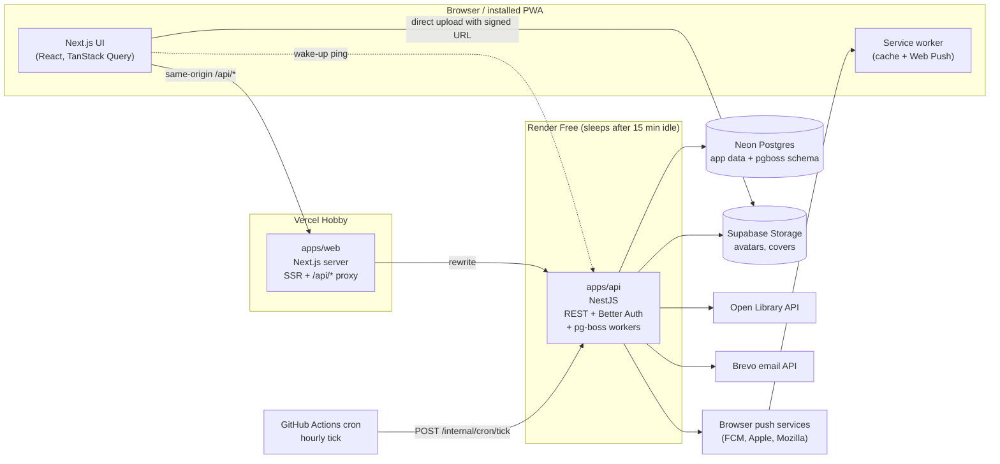
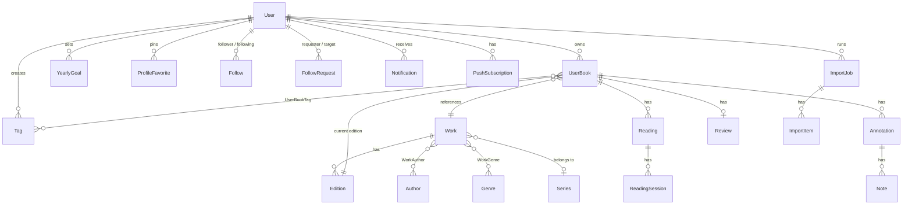
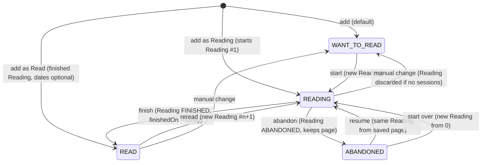

# Verso — Software Architecture

> Status: approved for F1 · Last updated: 2026-11-20
> Companion docs: `docs/DESIGN.md` (screens, visual identity), `ROADMAP.md` (task order), `CLAUDE.md` (rules for AI-assisted coding).

Verso is a personal-first reading platform. This document describes **how it is built**: stack, repository layout, data model, backend modules and classes, API, background jobs, security, testing and deployment.

Two constraints shape every decision:

1. **Everything runs on free tiers, with no credit card.** The app serves ~5 users and exists primarily as a portfolio project.
2. **Portfolio-grade engineering.** Clear layering, real business rules in testable domain classes, CI, typed contracts end to end.

---

## 1. Decisions at a glance

| Area | Choice | Why |
| --- | --- | --- |
| Language | TypeScript everywhere | One language, shared types across web and API |
| Monorepo | pnpm workspaces + Turborepo | Shared packages, cached builds and tests |
| Web | Next.js (App Router) on **Vercel Hobby** | SSR for landing and public profiles, free hosting |
| UI | Tailwind CSS + shadcn/ui, design tokens as CSS variables | Fast, accessible primitives; tokens from DESIGN.md |
| Client data | TanStack Query | Caching, retries, optimistic updates |
| i18n | next-intl (web) + shared message catalogs (`packages/i18n`) | English and Spanish; API also needs strings for emails and push |
| PWA | Serwist (service worker) + Web App Manifest + Web Push (VAPID) | Installable mobile experience with no native app |
| API | NestJS on **Render Free** | Modular structure, DI, guards; free web service |
| Database | PostgreSQL on **Neon Free** | Free, no card, scales to zero |
| ORM | Prisma | Typed client, migrations |
| Auth | Better Auth (email + password, Google) | Users live in our Postgres; sessions via cookies |
| Background jobs | **pg-boss** (queue inside Postgres) | No Redis to host; same database, transactional enqueue |
| Scheduling | **GitHub Actions cron** → `POST /internal/cron/tick` | Render Free sleeps, so in-process schedulers can't be trusted |
| File storage | **Supabase Storage Free** | Avatars and manual covers; no card required |
| Email | **Brevo HTTP API Free** (local: Mailpit) | Render Free blocks SMTP ports; Brevo works over HTTPS |
| Catalog source | Open Library API (no key) | Free; works/editions model matches ours |
| Validation & contracts | Zod schemas in `packages/shared`, OpenAPI generated from them | One source of truth for web, API and docs |
| Tests | Vitest (unit, integration), Playwright (e2e) | Fast, TS-native |
| CI | GitHub Actions (public repo) | Free, unlimited minutes for public repos |

What we deliberately **don't** use: Redis/BullMQ, WebSockets, native mobile app, paid email/storage, AI APIs (F5 only, not yet), Google Books (Open Library is enough).

---

## 2. System overview



### Request path and cookies

The browser only ever talks to the web origin (e.g. `verso-app.vercel.app`). `next.config` rewrites `/api/:path*` to the Render API. Session cookies are therefore **first-party** (`SameSite=Lax; Secure; HttpOnly`), which avoids third-party cookie blocking in Safari without owning a domain.

### Cold starts (Render Free)

Render spins the API down after 15 minutes without traffic; waking takes up to ~1 minute. Mitigations, all built in F1:

1. **Wake-up ping:** the landing page and sign-in page fire `GET {API_URL}/health` (no-cors, fire-and-forget) on load, so the API is warming while the user reads or types.
2. **Waking state in the UI:** the API client marks any request taking > 3 s; the app shows a sober banner: "Waking up the server. This can take up to a minute." (EN/ES). Requests that fail with 502/503/504 are retried with backoff for up to 75 s before showing the error state.
3. **Aggregated endpoints:** `GET /v1/home` returns everything the Home screen needs in one call, so a cold start costs one slow request, not six.

### Scheduling while the API sleeps

pg-boss's built-in scheduler only runs while the process is awake, so **no business schedule depends on it**. A GitHub Actions workflow calls `POST /internal/cron/tick` every hour with a shared secret. The tick wakes the API and enqueues whatever is due (reminders, cleanup, storage keep-alive). Jobs then run in-process via pg-boss.

---

## 3. Free-tier budget

| Service | Free allowance (Nov 2026) | Verso usage estimate | Risk and mitigation |
| --- | --- | --- | --- |
| Vercel Hobby | Non-commercial personal use | Tiny | Keep it non-commercial |
| Render Free | 750 instance-hours/month, sleeps after 15 min idle, **no outbound SMTP** | Hourly tick keeps it awake ≤ ~15 min/hour + real use | Cold starts (see above); email via HTTPS API |
| Neon Free | 1 GB storage per project, 100 CU-hours/month, scale to zero after 5 min | API awake ~8 h/day × 0.25 CU ≈ 60 CU-h/month | Keep compute at 0.25 CU; pg-boss polling only while API is awake |
| Supabase Free | Storage for small files; free projects can pause after inactivity | < 100 MB | Daily tick lists the bucket to register activity; verify current pause rule at setup |
| Brevo Free | 300 emails/day | A few per week | Single verified sender (the Verso Gmail address) |
| GitHub Actions | Unlimited minutes for public repos | CI + hourly cron | Keep the repo public |
| Open Library | Free, no key, asks for a descriptive User-Agent | Search and metadata | Cache responses in Postgres; batch imports at ~1 req/s |

If any free tier changes, each integration sits behind an interface (`EmailProvider`, `FileStorage`, `JobQueue`, `CatalogProvider`), so swapping a provider touches one class.

---

## 4. Repository layout

```
verso/
├─ apps/
│  ├─ web/                     Next.js app (UI, SSR, /api proxy, PWA)
│  └─ api/                     NestJS app (REST, auth, jobs)
├─ packages/
│  ├─ shared/                  Zod schemas, enums, DTO types, pure helpers used by both apps
│  ├─ i18n/                    en.json / es.json message catalogs (UI, emails, push)
│  └─ config/                  tsconfig bases, ESLint and Prettier configs
├─ docs/
│  ├─ DESIGN.md                Design specification (exported)
│  └─ adr/                     Architecture decision records (one file per decision)
├─ .github/workflows/          ci.yml, cron-tick.yml
├─ docker-compose.yml          Local Postgres + Mailpit
├─ ARCHITECTURE.md
├─ ROADMAP.md
├─ CLAUDE.md
└─ README.md
```

### apps/api

```
apps/api/src/
├─ main.ts                     bootstrap: helmet, CORS, pino, global pipes/filters
├─ app.module.ts
├─ common/                     cross-cutting: guards, filters, interceptors, pagination, errors
├─ infra/
│  ├─ prisma/                  PrismaService, transaction helper
│  ├─ jobs/                    JobQueue interface + PgBossJobQueue
│  ├─ email/                   EmailProvider interface + BrevoEmailProvider + SmtpEmailProvider (Mailpit, local only)
│  ├─ storage/                 FileStorage interface + SupabaseFileStorage
│  ├─ push/                    PushSender (web-push, VAPID)
│  └─ catalog/                 CatalogProvider interface + OpenLibraryProvider + ExternalCacheRepository
└─ modules/
   ├─ auth/  users/  catalog/  library/  reading/  annotations/
   ├─ reviews/  stats/  social/  notifications/  imports/  exports/
   ├─ admin/  cron/  health/
```

Each module follows the same internal layout:

```
modules/reading/
├─ reading.module.ts
├─ reading.controller.ts       HTTP only: parse, validate, call service, map response
├─ reading.service.ts          use cases; transactions; calls domain + repositories
├─ reading.repository.ts       Prisma queries only
├─ domain/                     pure classes, no Nest, no Prisma (unit tested)
│  ├─ progress.ts
│  ├─ reading-lifecycle.ts
│  └─ streak-calculator.ts
└─ reading.service.spec.ts     integration tests (real Postgres)
```

**Layering rule:** controller → service → (domain, repository). Controllers never touch Prisma. Domain classes never import Nest or Prisma. Cross-module calls go through the other module's exported service, never its repository.

### apps/web

```
apps/web/src/
├─ app/
│  ├─ (marketing)/page.tsx                 Landing (SSR, always-dark hero)
│  ├─ (auth)/sign-in | sign-up | verify-email | forgot-password | reset-password
│  ├─ onboarding/[step]/
│  ├─ (app)/                               authenticated shell: top bar (desktop), bottom tabs (< 768px)
│  │  ├─ home/  search/  works/[ref]/  authors/[id]/  series/[id]/
│  │  ├─ library/  library/[userBookId]/  books/new/
│  │  ├─ stats/  notifications/  settings/[section]/
│  │  ├─ import/goodreads/  admin/manual-books/
│  ├─ u/[username]/                        public profile (SSR + Open Graph image)
│  ├─ manifest.ts  sw.ts  opengraph-image.tsx
├─ components/
│  ├─ ui/                      shadcn primitives restyled with Verso tokens
│  └─ verso/                   BookCover, GeneratedCover, RatingInput, RatingDisplay, ProgressBar,
│                              AddToLibraryButton, StatusDropdown, LockToggle, TagChip, Streak, ...
├─ features/                   per-domain hooks and components (library/, reading/, social/, ...)
├─ lib/
│  ├─ api-client.ts            typed fetch; parses responses with shared Zod schemas; waking-state logic
│  ├─ query-keys.ts
│  └─ auth-client.ts           Better Auth client
└─ styles/tokens.css           color, type and radius tokens from DESIGN.md (light + dark)
```

Rendering strategy: the landing page and public profiles are server-rendered (SEO, link previews). Everything behind sign-in is client-rendered with TanStack Query, which keeps the Vercel side thin and makes the app shell cacheable by the service worker.

---

## 5. Domain model

### 5.1 Core concepts

- **Work** = a book as an idea. **Edition** = a specific printing (ISBN, language, page count). Search and book pages work at **work** level.
- The catalog stores only works and editions that a user actually added (or that the admin approved). Search, work pages and the edition list read Open Library through a Postgres-backed cache; nothing is persisted until a user adds a book.
- **UserBook** = a work in a user's library: status, rating, review, tags, privacy settings. Exactly one per user per work.
- **Reading** = one read-through of a UserBook. Rereads create a new Reading. At most one Reading is in progress per UserBook.
- **ReadingSession** = a manual progress log on a local date. Sessions drive streaks and stats.
- **Annotation** = a Highlight (literal text) or a Bookmark (page only). **Notes** hang from annotations (many per annotation).

### 5.2 Entity-relationship diagram (F1)



### 5.3 Tables (F1)

Conventions: primary keys are UUID v7 strings (`id`); timestamps are `timestamptz` in UTC (`createdAt`, `updatedAt`); enums are Postgres enums via Prisma; soft-delete only where stated.

**Auth (managed by Better Auth, extended):**

| Table | Key columns |
| --- | --- |
| `User` | `email` (unique), `emailVerified`, `name` (display name), `image` (avatar URL), **extended:** `username` (unique, citext), `bio`, `role` (USER, ADMIN), `profileVisibility` (PUBLIC, PRIVATE), `defaultAnnotationVisibility` (PUBLIC, PRIVATE), `ratingStyle` (STARS_WHOLE, STARS_HALF, STARS_QUARTER, DECIMAL_10, HUNDRED), `progressStyle` (PAGES, PERCENT), `locale` (en, es), `theme` (SYSTEM, LIGHT, DARK), `timeZone` (IANA, e.g. America/Hermosillo), `reminderEnabled`, `reminderTime` (HH:mm), `onboardingCompletedAt` |
| `Session`, `Account`, `Verification` | Better Auth defaults (Account holds the Google link) |

**Catalog:**

| Table | Key columns |
| --- | --- |
| `Work` | `title`, `subtitle`, `description`, `firstPublishYear`, `olWorkKey` (unique, nullable), `source` (OPEN_LIBRARY, MANUAL), `catalogStatus` (PUBLIC, PRIVATE), `reviewStatus` (NONE, PENDING, APPROVED, REJECTED, MERGED), `createdById` (manual books), `mergedIntoId`, `seriesId`, `seriesPosition` (decimal) |
| `Edition` | `workId`, `isbn10`, `isbn13` (unique, nullable), `title`, `publisher`, `publishYear`, `language` (ISO 639-1), `pageCount` (nullable), `format` (PAPERBACK, HARDCOVER, EBOOK, OTHER), `coverUrl`, `olEditionKey` (unique, nullable), `source`, `createdById` |
| `Author` | `name`, `bio`, `birthYear`, `deathYear`, `photoUrl`, `olAuthorKey` (unique, nullable) |
| `WorkAuthor` | `workId`, `authorId`, `position` |
| `Genre`, `WorkGenre` | `slug` (unique), `name`; join table |
| `Series` | `name`, `olSeriesKey` (nullable) |
| `ExternalCache` | `key` (unique, e.g. `ol:search:<hash>`), `payload` (jsonb), `expiresAt` |

**Library and reading:**

| Table | Key columns |
| --- | --- |
| `UserBook` | `userId`, `workId`, `editionId`, `status` (READING, READ, WANT_TO_READ, ABANDONED), `rating` (int 0–100, nullable), `hiddenFromProfile`, `annotationVisibility` (INHERIT, PUBLIC, PRIVATE), `progressStyle` (PAGES, PERCENT, nullable: null means "use `User.progressStyle`"; set when the user switches the toggle in the Log progress modal, see DESIGN S9), `archivedAt` (nullable, soft delete), `addedAt`; **unique** (`userId`, `workId`) |
| `Reading` | `userBookId`, `number` (1, 2, …), `state` (IN_PROGRESS, FINISHED, ABANDONED), `startedOn` (date, nullable), `finishedOn` (date, nullable), `currentPage` (nullable), `percentBp` (int 0–10000, basis points); partial unique index: one IN_PROGRESS per `userBookId` |
| `ReadingSession` | `readingId`, `userId` (denormalized for streak and stats queries), `localDate` (date in the user's time zone at write time), `fromPage`, `toPage`, `fromPercentBp`, `toPercentBp`, `pagesRead` (int, derived) |
| `Tag` | `userId`, `name`, `color` (WINE, TOBACCO, BRASS, FOREST, NAVY, OXBLOOD, SLATE, SAND); unique (`userId`, `name`) |
| `UserBookTag` | `userBookId`, `tagId` |
| `ProfileFavorite` | `userId`, `workId`, `position` (1–4); unique (`userId`, `position`) |
| `YearlyGoal` | `userId`, `year`, `targetBooks`; unique (`userId`, `year`) |

**Annotations and reviews:**

| Table | Key columns |
| --- | --- |
| `Annotation` | `userBookId`, `userId`, `type` (HIGHLIGHT, BOOKMARK), `page` (nullable), `percentBp` (nullable, for books without page count), `text` (highlights only), `visibility` (INHERIT, PUBLIC, PRIVATE), `isFavorite` (used from F2) |
| `Note` | `annotationId`, `userId`, `body` (text), `visibility` (INHERIT, PUBLIC, PRIVATE) |
| `Review` | `userBookId` (unique), `userId`, `workId` (denormalized for the work page), `body`, `visibility` (PUBLIC, PRIVATE), `containsSpoilers` (required when PUBLIC) |

**Social and notifications:**

| Table | Key columns |
| --- | --- |
| `Follow` | `followerId`, `followingId`, `createdAt`; PK (`followerId`, `followingId`) |
| `FollowRequest` | `requesterId`, `targetId`, `createdAt`; unique pair; deleted on accept/decline/cancel |
| `Notification` | `userId` (recipient), `type` (FOLLOW_REQUEST, NEW_FOLLOWER, FOLLOW_ACCEPTED, IMPORT_FINISHED, MANUAL_BOOK_APPROVED), `actorId` (nullable), `data` (jsonb), `readAt` |
| `PushSubscription` | `userId`, `endpoint` (unique), `p256dh`, `auth`, `userAgent` |

**Imports:**

| Table | Key columns |
| --- | --- |
| `ImportJob` | `userId`, `source` (GOODREADS), `status` (AWAITING_MAPPING, QUEUED, RUNNING, COMPLETED, FAILED), `detectedShelves` (jsonb), `shelfMapping` (jsonb), `totalRows`, `processedRows`, `importedCount`, `needsReviewCount`, `error`, `finishedAt` |
| `ImportItem` | `importJobId`, `rowIndex`, `raw` (jsonb), `status` (PENDING, IMPORTED, NEEDS_REVIEW, RESOLVED, SKIPPED), `userBookId` (nullable), `message` |

pg-boss creates and owns its own `pgboss` schema.

### 5.4 Tables added in later phases (not migrated in F1)

| Phase | Tables |
| --- | --- |
| F2 Wrapped | `WrappedSnapshot` (`userId`, `year`, `data` jsonb, `generatedAt`); `User.quoteOfYear` per year via `WrappedSnapshot` |
| F3 Feed | `Activity` (`actorId`, `type`, `entityType`, `entityId`, `createdAt`), `ActivityLike`, `ActivityComment` |
| F4 Clubs | `Club` (visibility PUBLIC/INVITE_ONLY, `inviteCode`), `ClubMember` (role CREATOR/MEMBER), `ClubBook` (dates, weekly goals, `chapters` jsonb), `ClubMemberProgress` (chapter reached), `ClubThread` (per chapter), `ClubPost`, `ClubVote`, `ClubVoteOption`, `ClubBallot` |
| F5 Recommendations | `Recommendation` (`userId`, `workRef`, `reason`, `batchId`), `RecommendationFeedback` (NOT_INTERESTED) |

Open question for F4 (decide before building it): chapter-based spoiler protection needs chapter progress, while F1 tracks pages. Proposed: each club book stores a chapter list, and members report "I'm at chapter N" inside the club, independent of page progress.

---

## 6. Business rules and domain classes

All of these are **pure TypeScript classes** with no framework imports, covered by unit tests. They are the heart of the project and the best interview material.

| Class | Location | Responsibility |
| --- | --- | --- |
| `Rating` | `packages/shared/src/rating.ts` | Value object, 0–100. `fromInput(style, value)`, `format(style)`. Conversions: whole stars = steps of 20, half = 10, quarter = 5; 1–10 with one decimal = value / 10; 1–100 = value. Shared so web and API format identically. |
| `Progress` | `apps/api/.../reading/domain/progress.ts` | Value object holding page and/or basis points. `fromPage(page, pageCount)`, `fromPercent(bp)`, `toPercent()`, `convertTo(pageCount)` for edition changes (150/300 → 200/400), `pagesSince(previous)`. Without `pageCount`, progress is percent-only. |
| `ReadingLifecycle` | `.../reading/domain/reading-lifecycle.ts` | State machine for a UserBook's status and readings (see below). Returns the list of changes to persist; the service applies them in one transaction. |
| `StreakCalculator` | `.../reading/domain/streak-calculator.ts` | Input: distinct session `localDate`s and "today" in the user's time zone. Output: current streak, longest streak, last 7 days. No grace days: a day without a session breaks the streak; today without a session doesn't break it yet. |
| `VisibilityResolver` | `.../social/domain/visibility-resolver.ts` | Resolves an item's effective visibility: item → parent annotation (for notes) → UserBook `annotationVisibility` → user `defaultAnnotationVisibility`. `INHERIT` walks up; the user level is never INHERIT. |
| `ProfileAccessPolicy` | `.../social/domain/profile-access-policy.ts` | `canViewProfileContent(viewer, owner, isApprovedFollower)`: owner always; public profile everyone; private profile only approved followers. `canShowOnWorkPage(review, author)`: only PUBLIC reviews by PUBLIC profiles. Hidden books (`hiddenFromProfile`) and their annotations and reviews never show to others. |
| `FollowPolicy` | `.../social/domain/follow-policy.ts` | Following a public profile creates a `Follow`; a private profile creates a `FollowRequest`. Switching a profile to public accepts all pending requests. No self-follow. Removing a follower deletes the `Follow` without blocking. |
| `GoodreadsCsvParser` | `.../imports/domain/goodreads-csv-parser.ts` | Parses the Goodreads export (Title, Author, ISBN, ISBN13, My Rating, Exclusive Shelf, Bookshelves, Date Read, Date Added, Read Count, My Review, Number of Pages). Strips Goodreads' `="..."` ISBN wrapping. |
| `ShelfMapper` | `.../imports/domain/shelf-mapper.ts` | Default mapping: read → READ, currently-reading → READING, to-read → WANT_TO_READ; shelves named like dnf, abandoned, did-not-finish → ABANDONED; all other shelves → tags. User can override per shelf. Star rating × 20 → 0–100. |
| `GeneratedCover` | `packages/shared/src/generated-cover.ts` | Deterministic color (from a title hash) out of {wine, tobacco, forest, navy, oxblood, slate} for books without a cover. |
| `UsernamePolicy` | `.../users/domain/username-policy.ts` | 3–20 chars, lowercase letters, digits, underscore; reserved words (admin, api, settings, u, …). |

### 6.1 Status and reading lifecycle



Rules:

- Logging progress that reaches the last page or 100% returns `suggestFinish: true`; the UI asks "Did you finish it?" and calls `finish`.
- "Read ×N" = count of FINISHED readings.
- Books marked READ with no dates count in totals but not in time-based stats.
- ABANDONED readings never count in stats.
- Rating and review are per UserBook (one each, editable), not per reading.
- Changing the edition during an in-progress reading converts progress through `Progress.convertTo`.
- Removing a book: **archive** sets `archivedAt` (hidden everywhere, restorable from Settings) or **delete permanently** cascades readings, sessions, annotations, notes, review and tags.

### 6.2 Stats rules

Computed with SQL over `ReadingSession` and `Reading` (no precomputed tables), cached per user in `ExternalCache` for 10 minutes and invalidated on writes:

- Books finished = FINISHED readings with `finishedOn` in range.
- Pages read = sum of `pagesRead` of sessions in range (percent-only books convert using the edition page count when known; otherwise excluded from page totals).
- Pace = pages read / days in range with at least one session.
- Genres and authors = from finished readings in range.
- Records: longest book (page count), fastest read (pages/day between `startedOn` and `finishedOn`), highest-rated.
- Calendar heatmap = pages per `localDate`.

---

## 7. Backend modules

| Module | Responsibilities | Main collaborators |
| --- | --- | --- |
| `auth` | Mounts Better Auth at `/api/auth/*`; `SessionGuard` (sets `req.user`), `AdminGuard`, `@CurrentUser()` decorator; sends verification and reset emails through `EmailProvider` | users, infra/email |
| `users` | Me, settings, onboarding, username availability, avatar upload URL, delete account | infra/storage |
| `catalog` | Book and author search, work and edition reads (cached), ISBN resolution, authors, series, persisting works and editions when added, manual book creation | infra/catalog |
| `library` | UserBooks, status changes (via `ReadingLifecycle`), tags, favorites, goals, archive and delete, Home aggregate | catalog, reading |
| `reading` | Readings, sessions, progress, streak | library |
| `annotations` | Highlights, bookmarks, notes, visibility toggles | social (visibility) |
| `reviews` | Create, update, delete review; work-page review list | social (access) |
| `stats` | Stats and calendar queries | reading, library |
| `social` | Public profiles, user search, follow, requests, followers lists, remove follower, privacy policies | notifications |
| `notifications` | In-app notifications, unread count, push subscriptions, dispatch to push | infra/push, infra/jobs |
| `imports` | Goodreads upload, shelf detection, mapping, background processing, review queue | catalog, library, infra/jobs |
| `exports` | Library export as CSV or JSON (streamed, synchronous at this scale) | library, annotations, reviews |
| `admin` | Manual books queue: approve, reject, merge | catalog |
| `cron` | `POST /internal/cron/tick`, protected by `CRON_SECRET`; enqueues due jobs | infra/jobs |
| `health` | `GET /health` (also the wake-up target) | — |

Side effects between modules use NestJS `EventEmitter2` events (e.g. `follow.requested` → notifications), so modules don't call each other in circles.

### Infrastructure interfaces

```ts
interface CatalogProvider {
  searchWorks(query: string, page: number): Promise<WorkSearchResult[]>;
  getWork(olWorkKey: string): Promise<ExternalWork>;
  listEditions(olWorkKey: string, opts: { language?: string }): Promise<ExternalEdition[]>;
  getEditionByIsbn(isbn: string): Promise<ExternalEdition | null>;
  getAuthor(olAuthorKey: string): Promise<ExternalAuthor>;
}

interface JobQueue {
  enqueue<T>(name: JobName, data: T, opts?: { singletonKey?: string; startAfter?: Date }): Promise<void>;
  work<T>(name: JobName, handler: (data: T) => Promise<void>): void;
}

interface EmailProvider { send(message: EmailMessage): Promise<void>; }
interface FileStorage { createUploadUrl(path: string, contentType: string): Promise<SignedUpload>; delete(path: string): Promise<void>; publicUrl(path: string): string; }
interface PushSender { send(subscription: PushSubscriptionData, payload: PushPayload): Promise<'sent' | 'gone'>; }
```

Implementations: `OpenLibraryProvider`, `PgBossJobQueue`, `BrevoEmailProvider` (prod) / `SmtpEmailProvider` (Mailpit, local), `SupabaseFileStorage`, `WebPushSender`. Tests use in-memory fakes of each.

### Open Library integration

- Search: `search.json` (fields limited to what we display), one result per work.
- Work: `/works/{key}.json`; editions: `/works/{key}/editions.json`; ISBN: `/isbn/{isbn}.json`; authors: `/authors/{key}.json`.
- Covers: use **cover-ID URLs** (`covers.openlibrary.org/b/id/{id}-M.jpg`), not ISBN-based cover lookups, which are rate-limited.
- All calls send `User-Agent: Verso/1.0 (contact email)`, time out at 8 s, and are cached in `ExternalCache` (search 1 day, works/editions/authors 30 days).
- Work references in the API are either a local UUID or `ol:OL123W`. Pages can render an Open Library work that isn't in our database yet; it is persisted (work + chosen edition + authors) only when a user adds it.

---

## 8. API

REST, JSON, versioned under `/v1`, documented with OpenAPI generated from the shared Zod schemas (`/docs` in development).

The API uses the global prefix `/api`, so `/v1/home` below is served at `/api/v1/home` and Better Auth at `/api/auth/*`. The web rewrite maps `/api/:path*` → `${API_URL}/api/:path*` one to one. Only `/health` and `/internal/cron/tick` live outside the prefix.

Conventions:

- Errors use RFC 7807 `application/problem+json`: `{ type, title, status, detail, code }`, where `code` is a stable string (e.g. `USERNAME_TAKEN`) that the web maps to an i18n message.
- Lists use cursor pagination: `?cursor=&limit=` → `{ items, nextCursor }`.
- Every authenticated route uses `SessionGuard`; admin routes add `AdminGuard`.
- Dates are ISO strings; ratings are 0–100 integers; percentages are basis points.

### Endpoints (F1)

**Auth (Better Auth, under `/api/auth`)**: sign-up/email, sign-in/email, sign-in/social (google), sign-out, get-session, verify-email, send-verification-email, forget-password, reset-password.

**Me and settings**

| Method | Path | Purpose |
| --- | --- | --- |
| GET | `/v1/me` | Current user, settings, onboarding state |
| PATCH | `/v1/me` | Name, username, bio, avatar (`avatarPath` after a signed upload, or `removeAvatar`; not both) |
| PATCH | `/v1/me/settings` | Rating style, progress style, locale, theme, time zone, privacy defaults. Reminder fields are rejected until P6 (F1.5) adds them |
| POST | `/v1/me/onboarding/complete` | Mark onboarding done |
| GET | `/v1/usernames/{username}/availability` | Live check |
| POST | `/v1/me/avatar/upload-url` | Signed upload URL (Supabase) |
| PUT | `/v1/me/favorites` | Four favorites |
| GET / PUT | `/v1/me/goals/{year}` | Yearly goal. `PUT` lands with onboarding step 6 (M2.5); `GET` with M5.6 |
| DELETE | `/v1/me` | Delete account (requires typed username) |

**Catalog**

| Method | Path | Purpose |
| --- | --- | --- |
| GET | `/v1/search/books?q=&genre=` | Works, one per book, with edition count and the viewer's status if in library; `genre` filters by subject (S3 genre chips) |
| GET | `/v1/search/users?q=` | Users (private ones show a lock) |
| GET | `/v1/works/{ref}` | Work page data |
| GET | `/v1/works/{ref}/editions?language=` | Edition selector |
| GET | `/v1/works/{ref}/reviews?cursor=` | Public reviews from public profiles, newest first |
| GET | `/v1/authors/{ref}` | Author page with works |
| GET | `/v1/series/{id}` | Series page |
| GET | `/v1/isbn/{isbn}` | Barcode scan → work ref |
| POST | `/v1/books/manual` | Create manual book (private, review PENDING) |
| POST | `/v1/books/manual/cover-upload-url` | Signed upload URL |

**Library, reading, annotations, reviews**

| Method | Path | Purpose |
| --- | --- | --- |
| GET | `/v1/home` | Aggregated Home payload |
| GET | `/v1/library?status=&tags=&sort=&cursor=` | Library list |
| POST | `/v1/library` | Add `{ workRef, editionRef?, status }` |
| GET | `/v1/library/{id}` | Book detail |
| PATCH | `/v1/library/{id}` | Status, rating, edition, hidden, annotation visibility |
| POST | `/v1/library/{id}/finish` · `/reread` · `/abandon` · `/resume` · `/start-over` | Lifecycle actions |
| POST | `/v1/library/{id}/archive` · `/restore` | Archive and restore |
| DELETE | `/v1/library/{id}` | Delete permanently |
| PUT | `/v1/library/{id}/tags` | Set tags |
| GET / POST / PATCH / DELETE | `/v1/tags`, `/v1/tags/{id}` | Tag management |
| GET | `/v1/library/{id}/readings` | Reading history |
| PATCH | `/v1/readings/{id}` | Edit dates |
| GET / POST | `/v1/library/{id}/sessions` | List and log progress (returns streak and `suggestFinish`) |
| PATCH / DELETE | `/v1/sessions/{id}` | Edit or delete a session |
| GET | `/v1/me/streak` | Current, longest, last 7 days |
| GET / POST | `/v1/library/{id}/annotations` | List (by page) and create highlight or bookmark |
| PATCH / DELETE | `/v1/annotations/{id}` | Edit, visibility, delete |
| POST | `/v1/annotations/{id}/notes` | Add note |
| PATCH / DELETE | `/v1/notes/{id}` | Edit, visibility, delete |
| PUT / DELETE | `/v1/library/{id}/review` | Upsert or delete review |

**Stats**: `GET /v1/me/stats?from=&to=` · `GET /v1/me/stats/calendar?year=`

**Profiles and social**

| Method | Path | Purpose |
| --- | --- | --- |
| GET | `/v1/users/{username}` | Profile header (and access flags) |
| GET | `/v1/users/{username}/library?status=` · `/reviews` · `/highlights` | Profile tabs (access-checked) |
| GET | `/v1/users/{username}/followers` · `/following` | Lists |
| POST / DELETE | `/v1/users/{username}/follow` | Follow or request; unfollow or cancel request |
| GET | `/v1/me/follow-requests` | Pending requests |
| POST | `/v1/me/follow-requests/{id}/accept` · `/decline` | Respond |
| DELETE | `/v1/me/followers/{userId}` | Remove follower |

**Notifications**: `GET /v1/notifications?cursor=` · `GET /v1/notifications/unread-count` · `POST /v1/notifications/read-all` · `POST /v1/notifications/{id}/read` · `POST /v1/push/subscriptions` · `DELETE /v1/push/subscriptions`

**Import and export**

| Method | Path | Purpose |
| --- | --- | --- |
| POST | `/v1/imports/goodreads` | Upload CSV (multipart, max 5 MB) → job with detected shelves |
| PUT | `/v1/imports/{id}/mapping` | Confirm shelf mapping → job QUEUED |
| GET | `/v1/imports/{id}` | Status and counters (polled every 3 s by the UI) |
| GET | `/v1/imports/{id}/items?status=NEEDS_REVIEW` | Review list |
| POST | `/v1/imports/{id}/items/{itemId}/resolve` | Pick the right work or keep as manual |
| GET | `/v1/me/export?format=csv\|json` | Download library export |

**Admin**: `GET /v1/admin/manual-books?status=PENDING` · `POST /v1/admin/manual-books/{id}/approve` · `/reject` · `/merge` (`{ targetWorkRef, targetEditionRef? }`; moves every user's UserBook, readings and annotations to the target in one transaction).

**Internal**: `POST /internal/cron/tick` (header `x-cron-secret`) · `GET /health`.

---

## 9. Background jobs (pg-boss)

| Job | Trigger | What it does |
| --- | --- | --- |
| `import.goodreads` | Mapping confirmed | Processes rows in batches of 20; per row: ISBN13 → ISBN10 → title + author search; creates UserBook, Reading(s), rating, review, tags; marks NEEDS_REVIEW when no confident match; throttled to ~1 Open Library request/second; updates counters; notifies on completion |
| `email.send` | Auth events | Sends via `EmailProvider`, retries 3× with backoff |
| `push.send` | Notification created (user has subscriptions) | Sends Web Push; deletes subscriptions that return 404/410 |
| `reminders.daily` | Cron tick (hourly) | For users with `reminderEnabled` whose local `reminderTime` falls in the past hour and no session today: enqueue `push.send` |
| `maintenance.cleanup` | Cron tick (daily) | Delete expired `ExternalCache`, notifications older than 90 days, finished import items older than 30 days; list the Supabase bucket (keep-alive) |

pg-boss settings: polling interval 10 s (keeps Neon compute low), retry limit 3, `singletonKey` for per-user jobs to avoid duplicates. Long jobs are idempotent and resumable: an import continues from `processedRows` if the API sleeps mid-job; the next tick re-enqueues RUNNING imports with no heartbeat in 5 minutes.

---

## 10. Security

- **Sessions:** Better Auth database sessions in an `HttpOnly; Secure; SameSite=Lax` cookie on the web origin; Better Auth's origin checks for CSRF on state-changing auth routes; our API also checks `Origin` against `WEB_ORIGIN` for non-GET requests.
- **Passwords:** Better Auth hashing (scrypt); minimum 8 characters; email verification required before social features; reset links expire in 1 hour.
- **Authorization:** every service method that reads another user's data goes through `ProfileAccessPolicy` / `VisibilityResolver`; ownership checks on every mutation (`userBook.userId === currentUser.id`). Integration tests cover each access rule.
- **Rate limiting:** `@nestjs/throttler` (in-memory, single instance): auth routes 10/min/IP, search 60/min/user, writes 120/min/user.
- **Input:** Zod validation on every body, query and param; CSV size and row limits (5 MB, 5,000 rows).
- **Uploads:** signed upload URLs with path scoped to the user (`avatars/{userId}/…`, `covers/{userId}/…`), images only, max 2 MB; the web compresses to WebP before upload.
- **Headers:** `helmet` on the API; Next.js security headers (CSP allowing Open Library covers and the Supabase storage host).
- **Secrets:** environment variables only; `.env.example` documents them; nothing secret in the repo (it's public).
- **Cron endpoint:** shared secret header, constant-time comparison.

---

## 11. Web app details

- **Design tokens:** `styles/tokens.css` defines the palette, type scale, radii and shadows from DESIGN.md for light and dark (`[data-theme]` via next-themes, default `system`). Tailwind reads the CSS variables. Components never use raw hex values.
- **Fonts:** Cormorant Garamond (display) and Inter (UI) through `next/font` (self-hosted at build, no runtime requests).
- **i18n:** next-intl without locale prefixes in URLs; locale comes from the user setting, else `Accept-Language`, else English. Catalogs live in `packages/i18n` so emails and push use the same strings. No hardcoded UI strings.
- **Forms:** react-hook-form + the same Zod schemas as the API.
- **Charts:** Recharts, styled with tokens (wine, tobacco, brass).
- **Barcode (F1.5):** `@zxing/browser` from the camera stream; falls back to manual ISBN entry.
- **PWA (F1.5):** `manifest.ts` (standalone, theme color wine, monogram icons); Serwist service worker: precache app shell, network-first with cache fallback for `GET /api/v1/*` read endpoints, push and `notificationclick` handlers. iOS gets push only when installed; Settings detects `display-mode: standalone`.
- **Open Graph:** `u/[username]/opengraph-image.tsx` renders a cover-style card for shared profile links.

---

## 12. Testing strategy

| Level | Tool | Scope | Runs |
| --- | --- | --- | --- |
| Unit | Vitest | Domain classes and shared helpers; target ≥ 90% line coverage on `domain/` and `packages/shared` | Every PR |
| Integration (API) | Vitest + Supertest + real Postgres | Services, repositories, guards and access rules through HTTP, using fakes for `CatalogProvider`, `EmailProvider`, `FileStorage`, `PushSender` | Every PR (Postgres service container) |
| Component | Vitest + Testing Library | Key components: RatingInput, ProgressBar, AddToLibraryButton, LockToggle | Every PR |
| End to end | Playwright | Critical journeys against the full local stack with Open Library mocked from fixtures | PRs to `main` |

E2E journeys: sign up → onboarding → add book → log progress → finish → rate and review · private profile → follow request → accept → content visible · Goodreads import of a 10-row fixture CSV · change edition mid-reading converts progress · archive and restore.

---

## 13. Environments and configuration

| Variable | App | Notes |
| --- | --- | --- |
| `DATABASE_URL` | api | Neon pooled connection (Prisma queries) |
| `DIRECT_DATABASE_URL` | api | Neon direct connection (migrations, pg-boss) |
| `BETTER_AUTH_SECRET`, `BETTER_AUTH_URL` | api | `BETTER_AUTH_URL` = web origin (cookies and redirects go through the proxy) |
| `GOOGLE_CLIENT_ID`, `GOOGLE_CLIENT_SECRET` | api | Google Cloud OAuth (free); redirect URI `https://<web>/api/auth/callback/google` |
| `WEB_ORIGIN` | api | Allowed origin |
| `BREVO_API_KEY`, `EMAIL_FROM` | api | Verified single sender |
| `SMTP_URL` | api | Local only (Mailpit) |
| `SUPABASE_URL`, `SUPABASE_SERVICE_ROLE_KEY`, `SUPABASE_BUCKET` | api | Server only, never in the web bundle |
| `VAPID_PUBLIC_KEY`, `VAPID_PRIVATE_KEY`, `VAPID_SUBJECT` | api (+ public key in web) | Generated once with `web-push generate-vapid-keys` |
| `CRON_SECRET` | api + GitHub secret | Tick authentication |
| `OPEN_LIBRARY_CONTACT` | api | Used in the User-Agent |
| `API_URL` | web | Render URL, used by rewrites and the wake-up ping |
| `NEXT_PUBLIC_VAPID_PUBLIC_KEY` | web | Push subscription |

**Local development:** `docker compose up` starts Postgres 16 and Mailpit (UI at `localhost:8025`); `pnpm dev` runs web (`:3000`) and API (`:4000`) through Turborepo; `pnpm db:migrate` and `pnpm db:seed` (seed: one admin, two users, a few books with sessions, highlights and follows).

---

## 14. CI/CD and deployment

**`.github/workflows/ci.yml`** (pull requests and `main`): install with pnpm cache → lint → typecheck → unit tests → integration tests (Postgres service) → build. E2E runs on PRs targeting `main`. Turborepo caches tasks.

**Deploy:**

- **Web:** Vercel Git integration; preview deployment per PR; production from `main`.
- **API:** Render auto-deploy from `main` using the API Dockerfile; start command runs `prisma migrate deploy` then starts the server. Health check `GET /health`.
- **Database:** Neon project `verso` with branch `main`; optional Neon branch per PR later.

**`.github/workflows/cron-tick.yml`:** `schedule: '0 * * * *'` → `curl -X POST -H "x-cron-secret: $CRON_SECRET" $API_URL/internal/cron/tick` with retries (the first attempt may hit a cold start).

Migrations are forward-only; never edit a migration after it's merged.

---

## 15. Observability

- Structured JSON logs with `pino` (request id, user id, route, duration); Render keeps recent logs.
- `GET /health` reports database connectivity and job queue status.
- Errors are logged with stack traces server-side; the client only sees problem+json.
- Sentry's free tier is a candidate for later; not in F1.

---

## 16. Decision log (ADRs)

Each decision gets a short file in `docs/adr/` (context, decision, consequences). Initial set:

1. **ADR-001 Free-tier-only infrastructure.** Portfolio project with ~5 users; no card. Consequence: cold starts, external cron, interface boundaries for providers.
2. **ADR-002 pg-boss instead of Redis + BullMQ.** One fewer service; transactional enqueue in the same database. Consequence: polling load on Postgres, acceptable at this scale; `JobQueue` interface allows swapping to BullMQ.
3. **ADR-003 Same-origin API proxy through Next.js.** No custom domain; first-party cookies. Consequence: an extra hop; long requests limited by proxy timeouts, so heavy work goes to jobs.
4. **ADR-004 Works/editions catalog with lazy persistence.** Avoids Goodreads-style edition chaos and junk entries. Consequence: work pages may read through cache for books nobody has added.
5. **ADR-005 Ratings stored as 0–100.** Display scale is a user preference; no migrations when scales change.
6. **ADR-006 Three-level visibility with inheritance.** Fine-grained privacy with simple defaults. Consequence: all reads of others' content go through one resolver.
7. **ADR-007 PWA instead of a native app.** One codebase, free distribution. Consequence: iOS push requires installation; no haptics on iOS.
8. **ADR-008 Email over HTTPS (Brevo).** Render Free blocks SMTP. Consequence: single-sender address until a domain exists.
9. **ADR-009 External cron for scheduling.** Render Free sleeps. Consequence: hourly granularity for reminders.
10. **ADR-010 Modular monolith with pure domain classes.** Right-sized for the project; business rules testable in isolation.
